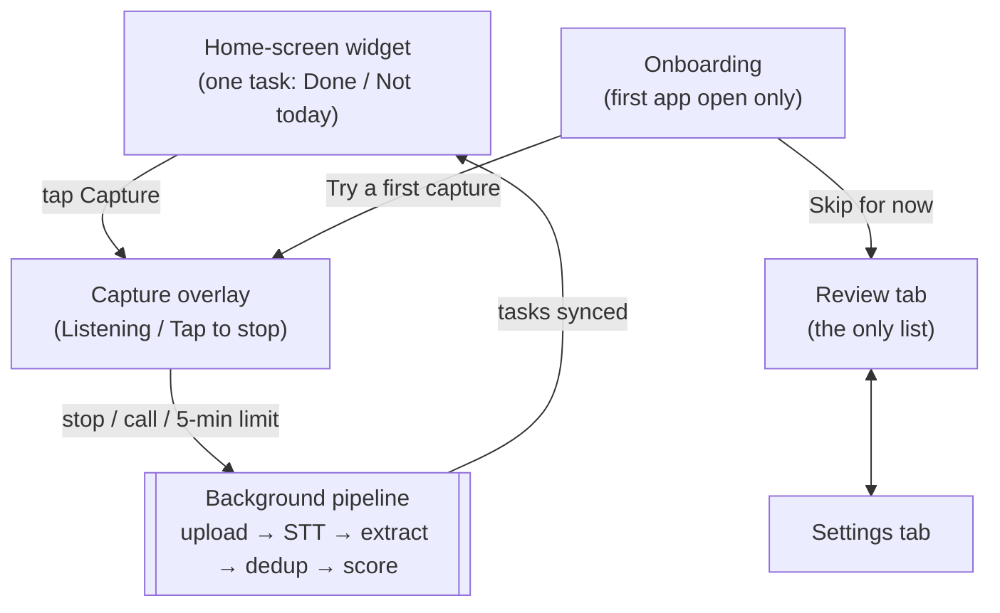
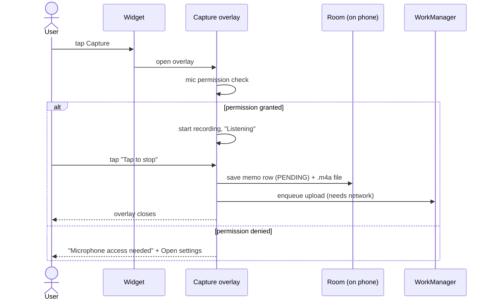
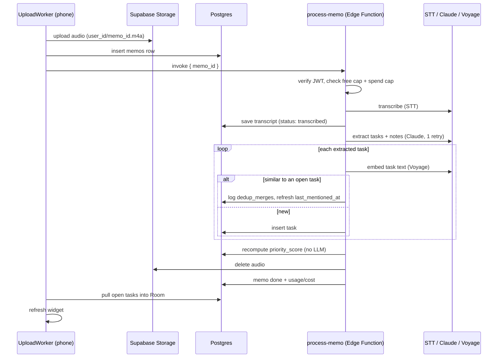
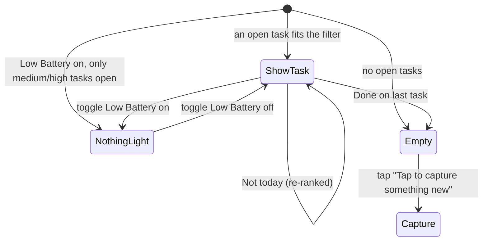

# Nudge — App Flow

Screen-by-screen and step-by-step flow of the Android app and its backend pipeline.

- **Source of truth:** `docs/prd.md`. This doc does not add requirements. Where it describes
  intended behavior, it cites the PRD section. If this doc and the PRD disagree, the PRD wins.
- **"Built" means written, not working.** Nothing on the Android side has been compiled (see
  `CLAUDE.md`, "Project status"). Each step below is marked:
  - **Spec**: what the PRD requires.
  - **Built**: what the current code does, with the file that does it.
  - **Gap**: where the two differ, or the PRD's requirement has no code yet.
- File paths are relative to `android/app/src/main/kotlin/com/nudge/app/` unless they start
  with `supabase/` or `docs/`.
- Last traced against the code: 2026-11-12.

---

## 1. Map of surfaces

There are only four places a user can be. The widget is the product (PRD §6, principle 3);
the app exists for setup, trust, and settings.

| Surface | File | Opens from |
|---|---|---|
| Widget | `widget/NextActionWidget.kt` | Home screen (user adds it) |
| Capture overlay | `capture/CaptureActivity.kt` | Widget, onboarding |
| Onboarding | `onboarding/OnboardingScreen.kt` | First launch of the app icon |
| Review | `review/ReviewScreen.kt` | App icon → Review tab (default) |
| Settings | `settings/SettingsScreen.kt` | App icon → Settings tab |
| Pipeline | `sync/UploadWorker.kt` → `supabase/functions/process-memo/index.ts` | End of every capture |

Not surfaces, on purpose: no task list on the widget, no calendar, no stats, no streaks
(PRD §5, M4).

---

## 2. Flow A — First launch

1. User installs and opens the app.
2. In the background, the app signs in anonymously and re-queues any unsent work.
   - Built: `NudgeApplication.kt` → `ServiceLocator.ensureSignedIn()`.
3. The onboarding screen shows (only once per device).
   - Spec (§6): "zero mandatory onboarding beyond mic permission + one sample capture;
     account creation deferrable."
   - Built: one screen, two buttons.
     - **Try a first capture** → marks onboarding done → opens the Capture overlay (Flow B).
     - **Skip for now** → marks onboarding done → Review tab.
4. Every later app open goes straight to the Review tab.

**Gaps**

- **First launch offline may crash (medium confidence).** `ensureSignedIn()` makes a
  network call inside a coroutine with no error handler. If it throws offline, the uncaught
  exception would normally crash the process. This is not verified at runtime. It matters
  because the very first capture is the most likely to happen with bad signal.
- **Captures before sign-in can't upload.** `CaptureRepository.currentUserId()` throws when
  no user exists. The memo stays saved locally, but it only uploads once sign-in succeeds,
  and nothing retries sign-in except the next app start.
- **No step tells the user to add the widget.** The widget is the main product, but
  onboarding never mentions it. Android needs the user to add widgets by hand.
- **The onboarding title uses an unconfirmed tagline.** "Speak it and forget it" is Open
  Decision 3 (PRD appendix, `CLAUDE.md`), which must be confirmed before use in
  user-facing text.
- **No email upgrade.** Anonymous accounts can't be upgraded yet, so uninstalling or
  switching phones loses everything.

---

## 3. Flow B — Capture (M1)

Step by step:

1. **Start.** User taps capture on the widget.
   - Spec (M1): recording active < 1.5 s after the tap (p90). Push-to-talk only.
   - Built: opens `CaptureActivity`, a thin overlay, which asks for mic permission and
     starts `MediaRecorder` (`capture/AudioRecorderController.kt`).
2. **Recording.** The overlay shows "Listening" and a **Tap to stop** button.
   - At 4:30 it adds "30 seconds left in this memo".
   - At 5:00 it stops on its own (free-tier limit; paid 15 min is not wired).
3. **Stop.** One of three things ends the recording:
   - The user taps stop.
   - A phone call or other audio takes over. The partial audio is kept (M1 edge case).
   - The 5-minute limit.
4. **Very short taps are thrown away.** Under 1 second is treated as an accidental
   tap-tap and deleted.
5. **Save locally first.** A memo row is written to Room with state `PENDING`, before any
   network use. This is what makes audio survive app kill, reboot, and offline (PRD §8).
6. **Queue the upload.** `UploadScheduler.enqueue` runs the upload once the phone is
   online. Then the overlay closes.

**Gaps**

- **High: the widget has no capture button while it shows a task.** Capture is only
  tappable in the empty state ("Tap to capture something new"). Once any task exists, the
  user can't capture from the widget at all. That breaks M1 and the main loop. The
  `widget_capture_cta` string ("Capture") exists in `strings.xml` but nothing uses it.
- **The permission-denied copy doesn't match the interaction.** It says Nudge listens
  "while you're holding down capture", but capture is tap to start, tap to stop.
- **"Captured — still thinking" only flashes.** The overlay shows it for a moment and then
  closes. After that, nothing anywhere shows that a memo is still processing (M2 error
  case: "user sees 'captured, still thinking' state").
- **The 1.5 s target is unmeasured.** It covers opening an Activity, the permission
  round-trip, and `MediaRecorder.prepare()`. It needs measuring on a mid-range device.

---

## 4. Flow C — Background processing (M2)

Invisible to the user by design (PRD §3: "I never face a triage screen").

What happens to each kind of input (Spec M2 → Built in `supabase/functions/process-memo/`):

| Input | What the user should end up with | Built? |
|---|---|---|
| Clear task ("buy milk") | A task with an effort tag | Yes (`extract.ts`) |
| Ambiguous ("deal with the Sarah thing") | The task kept word for word, low confidence, "Confirm this one" in Review | Yes, flag set below 0.6 confidence |
| Same task said again | Merged into the old task, and the merge visible in Review | Merge yes (`dedup.ts`); **visibility no** |
| Venting / no actions | Saved as a note; response acknowledges, no task invented | Note saved; **no acknowledgement shown anywhere** |
| Model returns bad output twice | Whole transcript saved as a note; nothing lost | Yes (fail-safe in `index.ts`) |
| STT/network failure | Retry; after 3 failures the memo is "stuck", the user is told once, and the audio is kept | Partly. See gaps |

**Gaps**

- **High: retries can't succeed (medium-high confidence, from reading the code).** On a
  retry, `CaptureRepository.uploadAndProcess` uploads the same storage path and inserts
  the same `memos` id again. If the first attempt got past either step, the retry fails on
  "already exists". So any memo whose *processing* failed once (e.g. an STT timeout)
  burns its retries and ends up `STUCK`. Fix: make both steps idempotent (storage upsert
  or skip-if-exists, insert-or-ignore on the row).
- **High: a memo can hang in `processing` forever.** If the Edge Function dies mid-run,
  the row stays `processing`, and the function returns early for that status on every
  retry. It needs a stale-processing timeout.
- **Hitting the free cap (5/day) looks like a failure.** The function returns 402, the
  phone treats it as an error, retries, and marks the memo `STUCK`. The user gets no
  calm message and the memo doesn't wait for tomorrow. The same applies to the new
  spend kill switch (429). This flow needs designing, with shame-free copy.
- **Notes are never shown.** A venting-only memo produces nothing visible. From the
  user's side, it looks like the app lost what they said.
- **No "stuck" notification.** The `capture_stuck_notice` string exists but is unused.
- **No push sync.** The PRD's data flow says "push sync → widget update". The widget only
  refreshes when the phone's own upload job finishes, so changes made elsewhere (e.g.
  another device) don't appear.

---

## 5. Flow D — Next action on the widget (M3, S1)

The widget's resting state, decided by `TaskDao.observeTopTask`: the open task with the
highest `priority_score`, filtered by Low Battery Mode.

| State | Text on widget | Actions |
|---|---|---|
| Show task | The task text, exactly as extracted | **Done**, **Not today**, Low battery toggle |
| Nothing light | "Nothing light left" / "Rest counts." | Low battery toggle |
| Empty | "Nothing waiting" / "Tap to capture something new." | Tap to capture, Low battery toggle |

How each action works (`widget/WidgetActionCallbacks.kt`):

1. **Done.** Marks the task done in Room right away, refreshes the widget, then queues the
   sync to Supabase. Spec: widget updates < 5 s.
2. **Not today.** Adds 1 to the skip count and recomputes the score locally. The task stays
   open. No visible penalty, no "skipped N times" anywhere (M3).
   - Fixed on 2026-11-12: a skip used to *raise* the score. See
     `supabase/migrations/0004_recency_and_cost.sql`.
3. **Low battery toggle.** Shows only low-effort tasks. Never forces a heavy one (M3 edge
   case).

**How the top task is picked** (`data/PriorityScore.kt`, mirrored in
`supabase/functions/process-memo/score.ts`). A fixed formula, no AI call:

- Low effort scores higher than high effort (weight 0.5).
- Recently *said* scores higher (weight 0.3; fades over a few days).
- Each skip lowers it a little, capped so a task is never buried for good (weight 0.2).

**Gaps**

- **"Not today" doesn't mean "not today".** One skip lowers the score by only 0.03, so a
  skipped task can come back the same day, even right away if few tasks are open. The PRD
  lists "not this week" as a separate future feature (C2), which implies "not today"
  should hide the task until tomorrow. **This is a product decision, not yet made.**
- **The widget can go stale.** Deleting a task in Review doesn't refresh the widget. The
  widget can keep showing the deleted task. Tapping Done on it then does nothing (the
  callback finds no task and returns quietly).
- **No micro-step hint (S2)** for high-effort tasks. This is a Should Have, not built.

---

## 6. Flow E — Review & correct (M5)

The only list in the product. For trust and fixing mistakes, not task management.

1. User opens the app → Review tab (default).
2. Shows every task that isn't done, newest first (`TaskDao.observeReviewList`).
3. Each card shows:
   - The task text.
   - "From this memo" (label only, see gaps).
   - "Confirm this one" button, only on low-confidence tasks. Tapping it clears the flag;
     the text is never rewritten (M2).
   - A delete icon. Deletion is instant, with no confirmation dialog (M5: "instant and
     unceremonious").
4. Empty: "Nothing to review right now."

**Gaps**

- **No edit.** M5 requires one-tap edit to fix mis-transcriptions. Only confirm and delete
  exist.
- **Traceability is a label, not a link.** "From this memo" shows on every card, but you
  can't see the memo, its transcript, or the `source_span` the task came from. M5 says
  every task must be traceable to its source memo.
- **Merges aren't shown** (`CLAUDE.md` gap 3). The `review_merged_from_label` string
  exists but is unused.
- **Notes aren't listed**, so venting memos and fail-safe transcripts have no home in the
  UI.

---

## 7. Flow F — Settings

Three switches (`settings/SettingsScreen.kt`). Each saves on the phone first, then tries
to sync to the `profiles` table.

| Setting | Default | Effect |
|---|---|---|
| Keep transcripts | On | Off → server deletes the transcript after extraction |
| Low battery mode | Off | Same as the widget toggle |
| Daily reminder | Off | Saves the flag only. **No notification is ever sent yet** (`CLAUDE.md` gap 5) |

**Gaps**

- **Privacy: "Keep transcripts" can show Off while the server still keeps transcripts.**
  The sync to `profiles` fails silently (`runCatching` in
  `data/preferences/NudgePreferences.kt`). For the privacy-focused persona (Dan), a toggle
  that lies is worse than having no toggle. It needs a retry queue or a visible "not
  synced yet" state.
- **"Delete account"** has a string but no button and no backend flow. The Play Store
  data-safety form will likely need one. This needs verification against current Play
  policy before launch.
- **No notification time picker.** `notification_hour` exists in the schema but not in the
  UI.

---

## 8. Flow G — Coming back after a break (M4, Open Decision 1)

- **Spec:** after an absence (the PRD's story uses two weeks), the user sees a calm
  "Welcome back — here's one thing" screen, not a backlog (PRD §3, M4). This is the main
  retention bet the beta tests.
- **Built:** only the strings (`welcome_back_title`, `welcome_back_body`). No screen, and no
  logic for what counts as "an absence" or where the screen appears (widget, app, or both).
- **Undecided:**
  - How long is "away"? The PRD gives no number.
  - Should the widget itself change, given that most users rarely open the app?
- Note: the widget already never shows a backlog or count. So the "no backlog" half of
  this works today without any extra screen; the "welcome back" half doesn't exist yet.

---

## 9. Failure paths at a glance

| Situation | Spec | Built today |
|---|---|---|
| Mic permission denied | Clear recovery screen | Yes: message + Open settings |
| Call during recording | Partial audio saved and processed | Yes (audio-focus loss) |
| Offline when capturing | Saved, uploads later | Yes (Room + WorkManager) |
| App killed / phone rebooted | Nothing lost | Yes in design: re-queued on next app start. Unverified |
| Upload fails 3 times | "Stuck", user told once, audio kept | Marked stuck; **no notice**; retries likely can't succeed (§4) |
| Model output invalid | Transcript kept as a note | Yes |
| Venting only | Note + acknowledgement | Note only |
| Free daily cap reached | Not specified | Shows up as an error → stuck (§4) |
| Daily spend cap reached | Kill switch | Server side only; same problem on the phone |
| First launch offline | Should still capture | Likely crash (§2) |

---

## 10. Gaps ranked

Order: what breaks the core loop (capture → one next action) first, then trust, then
polish.

| # | Gap | Section | Why it ranks here |
|---|---|---|---|
| 1 | No capture button on the widget while a task is shown | §3 | Breaks M1 and the main loop for anyone with ≥1 task |
| 2 | Retries hit "already exists" → memos go stuck | §4 | Silent capture loss from the user's view; breaks the zero-data-loss promise |
| 3 | Memo can hang in `processing` forever | §4 | Same: a captured thought never arrives |
| 4 | Possible crash on first launch offline | §2 | First-run failure is the worst time to fail |
| 5 | Free cap / spend cap turn into "stuck" | §4 | Looks like data loss; needs copy and a "wait until tomorrow" path |
| 6 | Venting-only memos give no feedback | §4, §6 | User can't tell saved from lost |
| 7 | "Keep transcripts" can silently not sync | §7 | Privacy promise can be false |
| 8 | Review has no edit and no real memo link | §6 | M5 acceptance criteria unmet |
| 9 | "Not today" semantics undecided | §5 | Product decision; affects whether skips feel respected |
| 10 | Widget goes stale after a Review delete | §5 | Confusing, not harmful |
| 11 | Return-after-absence screen missing | §8 | Core retention bet, but needs the decisions in §8 first |
| 12 | Stuck notice, daily reminder, merge visibility, email upgrade, delete account | various | Known follow-ups, mostly already in `CLAUDE.md` |

Confidence in this list: **medium**. It comes from reading the code, not running it. Items
2 and 4 depend on library behavior (Supabase Storage upload defaults, how supabase-kt
reports errors) that the first real Android Studio build and device test should confirm.

---

## 11. Open decisions that block flows

1. **What "Not today" means:** hide until tomorrow, or just rank lower? (§5)
2. **What counts as "coming back"**, and where the welcome-back state appears. (§8,
   PRD Open Decision 1)
3. **What the user sees at the free daily cap.** (§4)
4. **Onboarding tagline.** "Speak it and forget it" is PRD Open Decision 3. (§2)
5. **Whether notes get a visible home** (e.g. a section in Review), or just a one-line
   acknowledgement after capture. (§4, §6)
